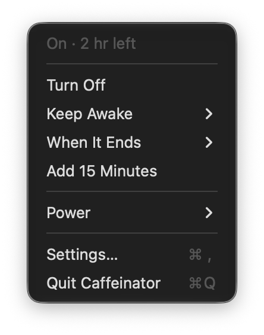
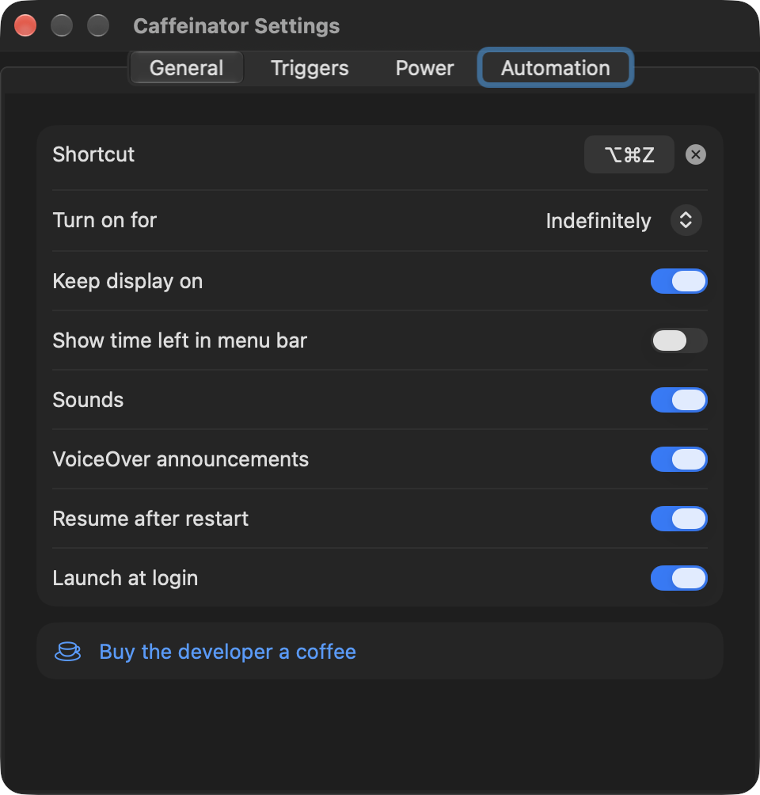

# Caffeinator

Your Mac is a gifted napper. Leave it alone for a few minutes and it dozes off mid-download, mid-render or mid-presentation. Caffeinator is the coffee: press ⌥⌘Z, or click the cup in the menu bar, and the Mac will stay up later than you do.

Caffeinator can also put the Mac to bed on your schedule (sleep, lock, log out, restart or shut down), and it can keep the Mac up by itself during calls or while the apps you pick are running. Press ⌥⌘A for [a screensaver](#screensaver) of live space, Earth, physics and math scenes that keeps the Mac awake while it plays. Everything works with VoiceOver. The app is native Swift with no dependencies, and the download is about 2.5 MB, screensaver included. Its photographs come later, when a scene first needs them.

Free, no ads, no tracking. If it rescues a render, [buy its developer a coffee](#donate).

## Install

With [Homebrew](https://brew.sh), and `brew upgrade` keeps it current:

```sh
brew install --cask pranav435/tap/caffeinator
```

Or by hand: download `Caffeinator.zip` from [Releases](https://github.com/Pranav435/caffeinator/releases/latest), unzip it, and move Caffeinator to Applications.

Either way, the first launch takes one extra step because the app isn't notarized. Notarizing costs $99 a year; this app costs nothing. ([Donate](#donate) has a plan for that.) Open Caffeinator once, then go to System Settings › Privacy & Security and click **Open Anyway**, or run:

```sh
xattr -dr com.apple.quarantine /Applications/Caffeinator.app
```

Requires macOS 14 or later. Runs natively on Apple silicon and Intel.

## Use

Click the cup to open the menu. A filled cup means the Mac is staying awake. An empty one means it's allowed to nap.

<p>


</p>

| Menu item | What it does |
|---|---|
| Turn On / Turn Off | Same as ⌥⌘Z |
| Keep Awake | 15 minutes to 8 hours, indefinitely, until an app quits, until CPU and network go quiet, or a custom time |
| When It Ends | Sleep, turn off the display, lock, log out, restart or shut down when the session ends |
| Add 15 Minutes | Extends a timed session |
| Power | Runs any of those actions now, or schedules one |
| Screensaver | Same as ⌥⌘A, or pick a scene |

Custom times take a length (`90m`, `2h`, `1h30`) or a clock time (`5pm`, `17:30`).

"Until activity stops" ends after two minutes with less than half a CPU core busy and under 50 KB/s of network traffic. Use it for renders, builds, exports, downloads, and anything else you'd otherwise babysit.

## Screensaver

Press ⌥⌘A and the Mac stays awake while the screen shows something worth staring at: the sky over you right now, the Moon at tonight's exact phase, Webb's Pillars of Creation, every satellite in orbit, a black hole bending the Milky Way around itself, an electron going through two slits. Each one runs live, on real physics, real math or recent public data. Where a real photograph or map exists, the scene uses it. The rest are shot like real experiments: slime mold in a petri dish, sand on a brass plate, a cloud chamber on black felt. Escape or ⌥⌘A again ends it, and Caffeinator goes back to whatever it was doing.

| Key | What it does |
|---|---|
| Escape or ⌥⌘A | Ends the screensaver |
| ← → | Previous or next scene |
| Space | Reads out what's on screen right now |
| M | Sound on or off |

Scenes change every 10 minutes, and each display gets a different one. A caption names each scene as it starts, and the clock drifts slowly so nothing burns in. It also starts by itself after 10 idle minutes (Settings can change that or turn it off), but only while Caffeinator is keeping the Mac awake, never over a video, and never on a locked screen. Pick a scene from the menu bar under Screensaver, or turn scenes off in Settings.

**Math and Chaos**

| Scene | What you see |
|---|---|
| Strange Attractors | The Lorenz butterfly and six of its chaotic cousins, light-painted in a hazy studio |
| Mandelbrot Deep Zoom | An endless dive into the Mandelbrot set, ten trillion times deeper, as if etched into a metal plate under studio light |
| Double Pendulums | A long exposure of two thousand LED-tipped pendulums released a millionth of a radian apart. They swing as one until chaos fans them out |
| Lenia | Creatures made of nothing but a rule, the Orbium gliders of a continuous Game of Life, swimming under a darkfield microscope |
| Belousov–Zhabotinsky Reaction | A chemical clock in a petri dish: blue rings and spirals spreading through orange liquid |
| Kuramoto Fireflies | Two thousand fireflies over a misty meadow blink out of step, then fall into one rhythm, under tonight's real Milky Way |

**Physics**

| Scene | What you see |
|---|---|
| Black Hole | A ray-traced Schwarzschild black hole bending a real photograph of the Milky Way. Its disk blazes on the side rushing toward you |
| Ink in Water | Drops of Prussian blue, vermilion and gold sink through a backlit glass tank in plumes and vortex rings, a Navier–Stokes fluid |
| Slime Mold | A million agents grow a yellow Physarum network on agar in a petri dish. Now and then oat flakes appear at the cities around Tokyo, and they rebuild its rail map |
| Northern Lights | A long exposure of aurora over a fjord under the real stars, as lively as the geomagnetic activity right now |
| Double Slit | Electrons land one flash at a time on a phosphor screen and slowly build the interference fringes, as in Tonomura's experiment, with the Schrödinger equation solved live beside it |
| Hydrogen Orbitals | The exact hydrogen wavefunctions from 1s to 6h, as a photoionization microscope sees them, over hydrogen's real spectral lines |
| Cloud Chamber | Cosmic-ray muons, radon alphas and stray electrons condense into tracks at their real rates, over black felt in a side-lit chamber |
| Chladni Plate | Sand gathers on the still lines of a vibrating brass or aluminium plate, lit like a studio photograph |

**Space**

| Scene | What you see |
|---|---|
| Night Sky | The sky over you right now on a real photograph of the Milky Way: 5,000 stars, the planets, the Moon's real surface and any active meteor shower |
| The Moon Tonight | The real Moon from NASA's Lunar Reconnaissance Orbiter maps, at this minute's exact phase and tilt, with the telescope drifting along the shadows of the terminator |
| Webb and Hubble | Slow drifts across real Webb and Hubble images, from the Pillars of Creation to the deep fields, labelled like a scientific figure |
| Mars from Orbit | A flight over real Martian terrain from orbital elevation maps (Jezero, Mount Sharp, Valles Marineris, Victoria crater), with the Sun where it stands there right now |
| Orrery | The planets with their real surface maps, where they are today, then racing ahead three days a second around a live photo of the Sun. Each hums its orbital frequency, as Kepler imagined |
| Every Known Exoplanet | Over 6,000 confirmed planets circling one star, famous systems in the spotlight (some with real telescope images), and this month's asteroid flybys |
| Gravitational Waves | Real black hole mergers from LIGO, Virgo and KAGRA bending the Milky Way, with the detectors' actual strain data, its chirp and its sound |
| Pulsar Map | The pulsar map from the Pioneer plaque in 3D, over the real Milky Way. Each pulsar flickers and clicks at its true rate |
| Deep Space Network | Which of NASA's dishes are talking to which spacecraft right now, from the Moon to Voyager 1 |

**Live Earth**

| Scene | What you see |
|---|---|
| Live Earth | The whole Earth from the nearest weather satellite, with the last few hours of clouds on a loop |
| Whole Earth | Today's photographs of the sunlit Earth from NASA's EPIC camera, 1.5 million km away, played as one slow turn |
| The Sun Today | NASA SDO's newest pictures of the Sun, dissolving through eight wavelengths, with today's X-ray flux |
| Window to the Sky | Your sky right now through a window: physically computed sunlight, today's clouds on today's wind, rain on the glass if it's falling, and the real stars and Moon at night |
| Earthquakes | The last day's earthquakes, replayed in a minute and a half on a photographic globe with today's clouds |
| Every Satellite | Every active satellite, about 16,000 of them, moving in real time, and the ISS with its ground track |
| Aurora Oval | NOAA's aurora forecast, glowing over the night side of the real Earth |
| Time, All of It | UTC, Unix, Julian, sidereal, atomic and GPS time, Mars time at the Perseverance rover, and how long Voyager 1's signal takes to reach us |

Every scene has its own soundscape made from what's on screen: the orrery plays the planets' orbits as a chord, the gravitational-wave chirps rise like the real ones, crickets outside the window chirp at the rate the real temperature sets. Sound is off until you turn it on in Settings or press M.

Scenes that show the sky or the satellites overhead use your location. macOS asks once, after you end the screensaver, so the prompt never pops up over it. Without it they go by your time zone.

### Data and privacy

The live scenes fetch public data straight from the source, with no server in between: USGS earthquakes; NOAA SWPC aurora, Kp and X-ray data; NASA's SDO images, Deep Space Network status and Exoplanet Archive; JPL close approaches; GWOSC and GraceDB gravitational-wave events and strain data; CelesTrak orbits; CIRA RAMMB SLIDER satellite imagery; and Open-Meteo weather. Star positions come from Olaf Frohn's [d3-celestial](https://github.com/ofrohn/d3-celestial) (BSD), coastlines from [Natural Earth](https://www.naturalearthdata.com), and pulsar values from the ATNF catalogue.

The photographs and maps are public domain or CC BY 4.0, and each scene's caption credits the ones it shows. They come from ESO, including S. Brunier's Milky Way panorama; ESA/Webb and ESA/Hubble; NASA's Blue Marble, Black Marble, GIBS VIIRS clouds, EPIC and SDO images; the LRO maps from NASA's Scientific Visualization Studio; USGS Astrogeology's Mars terrain models from MRO's CTX and HiRISE cameras; and planet maps from [Solar System Scope](https://www.solarsystemscope.com/textures/).

Only Window to the Sky sends anything about you: your location, rounded to about 11 km, so Open-Meteo can report the weather there. Everything is cached in `~/Library/Caches/io.github.pranav435.caffeinator`, so scenes work offline with the last copy, and in Low Data Mode they use only the cache. Live Earth and The Sun Today are the heavy ones, with up to 40 MB of imagery when they start and a few megabytes every 10 to 15 minutes while they're on screen. Photographs and maps download the first time a scene needs them: a few megabytes for most scenes, about 46 MB for The Moon Tonight, and 6 to 22 MB for each Mars site. They're kept for months, and the cache trims itself once it passes 1 GB.

## Settings

**General:** the shortcut, how long the shortcut and Turn On keep the Mac awake, whether the display stays on, time left in the menu bar, sounds, VoiceOver announcements, resume after restart, launch at login.

**Triggers:** stay awake while the camera or mic is in use, while plugged in, while an external display is connected, while someone is connected over SSH or Screen Sharing, or while apps you pick are running. It won't doze off during your video call, which is more than can be said for some of the attendees. Turn off when the battery drops below a set level, because a dead battery wins every argument. After you've been away for a set time, let the Mac sleep, lock the screen, or turn off the display. When you leave, it takes the hint.

**Power:** a warning of 30 seconds to 5 minutes before sleep, log out, restart and shut down, with an optional audio fade-out for anyone who falls asleep to podcasts. A nightly routine gives the Mac a bedtime: one action at a set time. It can wait until you've been idle for 10 minutes, so it won't pull the plug mid-sentence at 1 AM.

**Screensaver:** its shortcut, starting by itself after 5 to 60 idle minutes, how often scenes change, the clock, captions, sound and its volume, locking the Mac when it ends, or using the macOS screen saver instead. Every scene has a description, a checkbox and a Preview button.

**Automation:** run a shortcut from the Shortcuts app when Caffeinator turns on or off. Set a Focus, start a playlist, dim the lights: whatever your ritual is.

Turning Caffeinator off while a trigger is active pauses that trigger until its condition clears.

## URL commands

Use these from Terminal, Shortcuts, Raycast or scripts. Quote the URL in a shell.

| Command | Effect |
|---|---|
| `caffeinator://on` | On, no time limit |
| `caffeinator://on?for=90m` | On for 90 minutes |
| `caffeinator://on?until=5pm&then=sleep` | On until 5 PM, then sleep |
| `caffeinator://on?app=Xcode` | On until Xcode quits |
| `caffeinator://on?pid=1234` | On until process 1234 exits |
| `caffeinator://on?until=activity` | On until CPU and network go quiet |
| `caffeinator://off`, `caffeinator://toggle` | Off, or toggle |
| `caffeinator://sleep` | Sleep now. Also `display-off`, `lock`, `logout`, `restart`, `shutdown` |
| `caffeinator://shutdown?in=30m` | Schedule it. `at=11pm` works too |
| `caffeinator://cancel` | Cancel the countdown and any scheduled action |
| `caffeinator://screensaver` | Start the screensaver. `?scene=black-hole` picks a scene, `?off` ends it |
| `caffeinator://settings` | Open Settings |

`then=` takes the same action names. For example, to keep the Mac awake through a render and shut down when it exits:

```sh
./render.sh & open "caffeinator://on?pid=$!&then=shutdown"
```

Log out, restart and shut down requested by URL always show at least a 30-second warning. A web page can order a coffee, but it can't order a shutdown without notice.

## VoiceOver

- Every control has a label. The menu bar item reads its state, such as "Caffeinator, On, 42 minutes left".
- Turning on or off, timer endings, battery and away guards, and warnings are announced without moving focus.
- The shortcut recorder refuses Control-Option combinations, since VoiceOver got there first.
- Cancel is the default button in warnings, so Return or Escape stops a shutdown.
- The screensaver announces each scene. Space reads out what's on screen right now, such as which spacecraft a dish is talking to or where the ISS is, and every scene's description is in Settings. Any other key reminds you that Escape ends it.

## Donate

Caffeinator has no ads, no account, no subscription, no "Pro" tier and no analytics. The only time it goes online is to fetch the screensaver's public data, straight from the source. This section is the only part of the project that wants anything from you.

Your Mac stays up on Caffeinator. Caffeinator stays up on its developer. Its developer stays up on coffee. You can see where this is going.

Notarization fund: **$0 of $99**.

| Order | What it does |
|---|---|
| [Espresso, $3](https://paypal.me/theblindiephoenix/3USD) | Covers one cup and one bug fix, in that order |
| [Flat white, $5](https://paypal.me/theblindiephoenix/5USD) | Costs the same as a café coffee, which lasts an afternoon. Caffeinator lasts as long as your Mac does |
| [Bag of beans, $20](https://paypal.me/theblindiephoenix/20USD) | Fuels a whole feature, from the first idea to the 2 AM bug it ships with |
| [A year of notarization, $99](https://paypal.me/theblindiephoenix/99USD) | Goes toward Apple's developer fee, so the app can be notarized and "Open Anyway" disappears for everyone |
| [Your own amount](https://paypal.me/theblindiephoenix) | All currencies are converted to coffee at a fair rate |

If Caffeinator has saved one download, render or presentation from a surprise nap, that's about one coffee's worth. Can't spare the money? A star on the repo costs nothing, and yes, someone checks.

### Fueled by

Add a note to your PayPal payment if you'd like your name here.

<!-- donors: scripts/donation.sh adds names below this line -->
Empty, like a mug on Monday morning.

## How it works

Caffeinator holds an IOKit power assertion (`PreventUserIdleDisplaySleep`, or `PreventUserIdleSystemSleep` when the display may sleep), the same mechanism `caffeinate` uses. Run `pmset -g assertions` to see it, along with whatever else has been keeping your Mac up at night.

The shortcut uses Carbon's `RegisterEventHotKey`, which needs no Accessibility permission. Triggers listen for system notifications instead of polling. A 30-second timer runs only while the Mac is being kept awake or the remote-session trigger is on.

Log out, restart and shut down send loginwindow the same Apple events as the Apple menu, without its confirmation dialog, so apps with unsaved work can still cancel them. macOS asks for Automation permission the first time. Lock calls `SACLockScreenImmediate` from login.framework.

Each screensaver scene is a set of Metal shaders, compiled from source inside the app when the scene starts. Simulations such as the fluid, the slime mold and the Schrödinger solve run on the GPU. Photographs are decoded off the main thread into mipmapped textures, and the scenes share one simulated camera for exposure, bloom, vignetting and film grain. The Milky Way photograph is aligned to 393 catalogue stars, so it lines up with the real sky to a tenth of a degree. Most scenes render below full resolution and are scaled up, and the screensaver drops to 30 frames a second on battery. Sound comes from a small synthesizer on `AVAudioEngine`.

Scheduled actions keep the Mac from idling to sleep until they run. If the Mac sleeps anyway, for example with the lid closed, a missed action is skipped instead of running late. A 2 AM shutdown has no business happening at 9 AM.

## Build

```sh
scripts/build.sh            # build/Caffeinator.app, universal, ad-hoc signed
scripts/build.sh --install  # also copies it to /Applications and relaunches
swift test --scratch-path /tmp/caffeinator-build
swift scripts/make-art.swift  # redraws the icon, docs/icon.png and the social preview card
build/Caffeinator.app/Contents/MacOS/Caffeinator --snapshot all ~/Desktop/shots --audio
                            # renders every screensaver scene to PNG and records its soundscape
```

Requires Xcode 16 or later. The scripts compile outside the repo, so a checkout in iCloud Drive works.

## Release

Releases are built and published from a Mac. No CI, no YAML:

```sh
scripts/release.sh 1.0.1 --dry-run  # tests and builds, then shows the release notes
scripts/release.sh 1.0.1            # also tags, pushes and publishes the GitHub release
```

It needs a clean `main` and the [GitHub CLI](https://cli.github.com) signed in. The release gets the zip, install steps, its SHA-256 and GitHub's generated changelog, and the [Homebrew cask](https://github.com/Pranav435/homebrew-tap) moves to the new version.

When a donation comes in, `scripts/donation.sh 5 "Ada L."` adds it to the fund in this README, lists the name (leave it out for anonymous donors), commits and pushes.

## License

MIT, see [LICENSE](LICENSE). Use it, change it, ship it; just keep the copyright notice. It comes with no warranty, not even a warranty of wakefulness.
